# brpc 链路管理、调度与故障识别/恢复机制分析

> 分析对象：本仓库 brpc（Apache bRPC）客户端与服务端核心代码。
> 关注三条主线：**链路管理**（连接建立、复用、收发、回收）、**调度**（bthread M:N 调度、epoll 事件调度、RPC 选路调度）、**故障识别与恢复**（错误检测、熔断、健康检查、重试、backup request、集群恢复）。
> 文中 `file:line` 均可在仓库中直接定位。

---

## 1. 总体架构

brpc 的核心设计是：**用 Socket 抽象一条连接，用 SocketMap 按对端共享连接，用 bthread 把 I/O 事件与业务处理解耦，用分层策略完成故障隔离与恢复**。

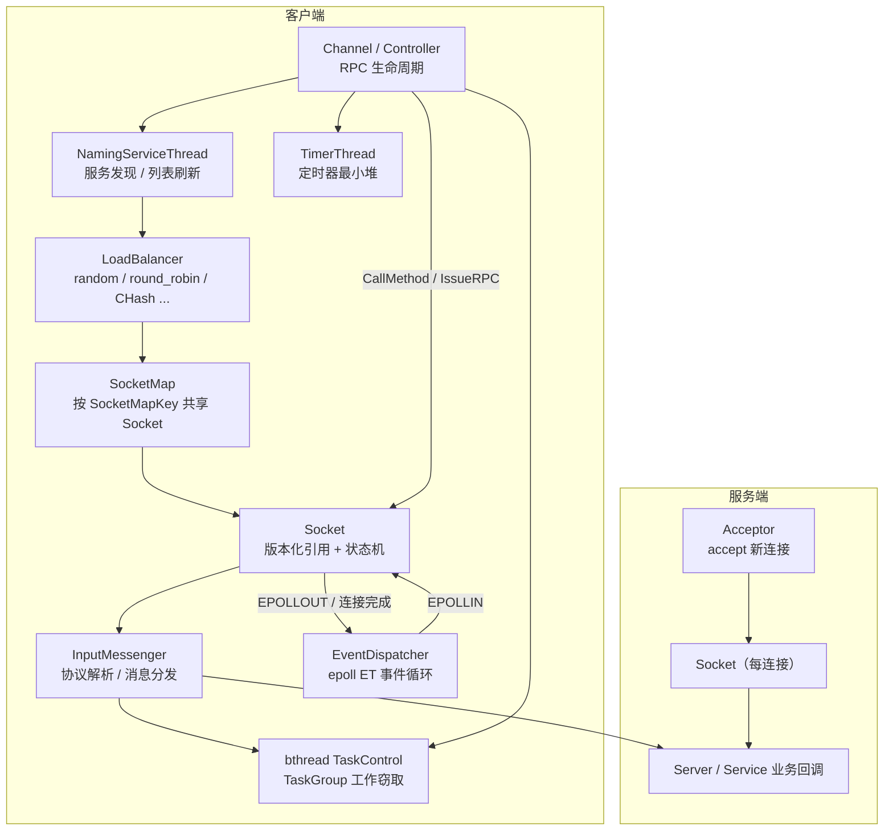

| 角色 | 主要源码 | 职责 |
|---|---|---|
| Channel / Controller | `src/brpc/channel.cpp`、`src/brpc/controller.cpp` | 发起 RPC、超时、重试、backup、熔断反馈 |
| NamingServiceThread | `src/brpc/details/naming_service_thread.cpp` | 周期性拉取服务列表，增删 Socket |
| LoadBalancer | `src/brpc/load_balancer.cpp`、`src/brpc/policy/*` | 选节点、排除失败节点、集群恢复控制 |
| SocketMap | `src/brpc/socket_map.cpp` | 同一对端（+ 通道签名）共享连接、空闲回收 |
| Socket | `src/brpc/socket.cpp`、`socket.h`、`socket_inl.h` | 连接状态机、读写、版本化引用、健康检查 |
| InputMessenger | `src/brpc/input_messenger*.cpp` | 读事件入口、协议切分、业务分发 |
| EventDispatcher | `src/brpc/event_dispatcher*.cpp` | epoll ET 事件循环 |
| bthread | `src/bthread/*` | M:N 协程调度、定时器 |
| Acceptor | `src/brpc/acceptor.cpp` | 服务端接入、连接数与空闲管理 |

---

## 2. 链路管理

### 2.1 连接建立与共享

客户端并不是"每个 Channel 一条连接"，而是通过 `SocketMap` 按 **`SocketMapKey = (ServerNode, ChannelSignature)`** 共享连接：

- `ServerNode`：`EndPoint + tag`；
- `ChannelSignature`：由 SSL、认证、client_host、device_name、connection_group、health_check_path 等影响连接语义的选项计算得到（`src/brpc/channel.cpp:80`）。

相同 key 的 Channel 复用同一个 `Socket`，`SocketMap` 用 `ref_count` 记录引用数；最后一个引用释放后，根据 `defer_close_second` 延迟关闭（`src/brpc/socket_map.cpp:237-333`）。

连接建立的主流程：

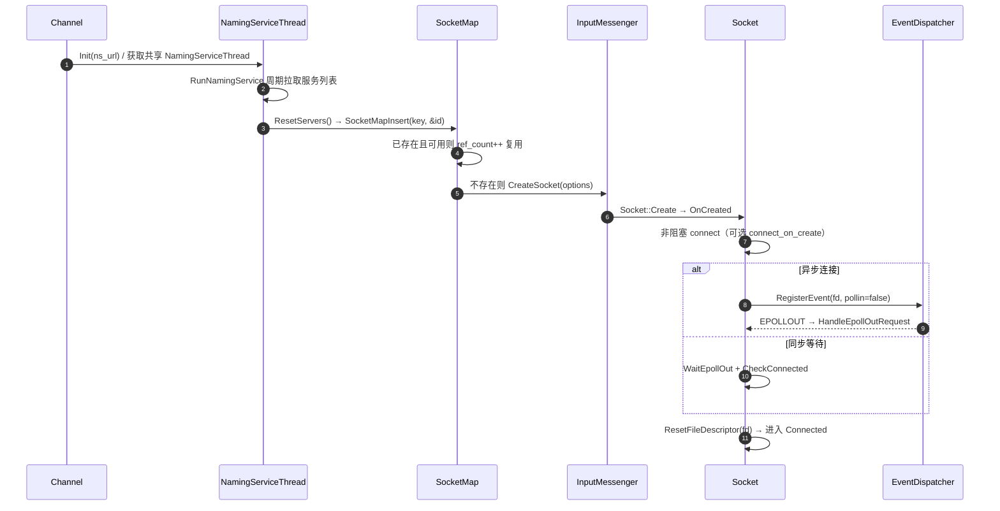

关键点：

- `SocketMap::Insert` 若发现已有 Socket 处于 failed 且 **未开启健康检查**，会替换为新 Socket；若开启了健康检查，则继续复用，等待其被探测恢复（`src/brpc/socket_map.cpp:243-256`）。
- 服务端列表变化时，`ResetServers` 对新节点做 `SocketMapInsert`，对下线节点做 `SocketMapRemove`，并按差集通知 watcher（`src/brpc/details/naming_service_thread.cpp:92-191`）。
- 连接类型 `connection_type` 支持 `single`、`pooled`、`short`：
  - `pooled` 连接在 RPC 结束后归还 `SocketPool`，`idle_timeout_second`（默认 30s）控制空闲回收；
  - `short` 每次请求后关闭；
  - 连接池相关逻辑见 `Socket::GetPooledSocket / ReturnToPool / ListPooledSockets`（`src/brpc/socket.cpp:2807-2918`）。

### 2.2 连接生命周期状态机

`Socket` 用**版本化引用计数**（`VersionedRefWithId`）保证 `SocketId` 在并发访问下不会悬垂：`SetFailed()` 不会立即析构对象，而是把版本号推进、让后续 `Address()` 失败；对象在引用计数归零后才回收（`src/brpc/socket.h:520-532`、`src/brpc/versioned_ref_with_id.h`）。

```mermaid
stateDiagram-v2
    [*] --> Created: Socket::Create / OnCreated
    Created --> Connecting: DoConnect 非阻塞 connect
    Connecting --> Connected: EPOLLOUT / CheckConnected 成功
    Connecting --> Failed: 连接失败 / 超时
    Connected --> Active: Write / Read
    Active --> Active: 正常收发 / KeepWrite
    Active --> Failed: 读写错误 / EOF / 空闲超时 / 熔断隔离
    Failed --> HealthChecking: HCEnabled 时 StartHealthCheck(delay)
    HealthChecking --> HealthChecking: CheckHealth 失败，按间隔重试
    HealthChecking --> Revived: CheckHealth 成功 → Revive(2)
    Revived --> Connecting: 下一次 Write → ConnectIfNot 惰性重连
    Failed --> Recycled: 无健康检查，引用归零
    Connected --> Recycled: 引用归零且超过 defer_close
    Revived --> Recycled: 引用归零
    Recycled --> [*]
```

`Failed` 之后能否恢复，取决于 `HCEnabled()`：

```cpp
// src/brpc/socket.h:482
bool HCEnabled() const {
    return _health_check_interval_s > 0 && _is_hc_related_ref_held;
}
```

客户端经 `SocketMap` 创建的 Socket 默认 `health_check_interval_s = FLAGS_health_check_interval`（默认 3s，`src/brpc/socket_map.cpp:34-37,71`），因此客户端连接默认具备自愈能力；服务端 accept 出来的连接一般不带健康检查，失败后随引用释放而回收。

### 2.3 数据接收链路

I/O 采用 **epoll 边缘触发 + 每个 Socket 最多一个处理 bthread** 的模型：

1. `EventDispatcher::Run()` 在独立 bthread 中 `epoll_wait`，先处理 `EPOLLIN|EPOLLERR|EPOLLHUP`，再处理 `EPOLLOUT`（`src/brpc/event_dispatcher_epoll.cpp:203-250`）。
2. 回调进入 `Socket::OnInputEvent`，用 `_nevent.fetch_add(1)` 做去重：只有第一个事件会创建处理 bthread，避免同一 fd 被重复调度（`src/brpc/socket.cpp:2281-2296`）。
3. `InputMessenger::OnNewMessages` 循环 `DoRead`，交给 `InputMessengerProcessor::ProcessNewMessage` 切分报文（`src/brpc/input_messenger.cpp:103-161`、`src/brpc/input_messenger_processor.cpp:175-293`）。
4. 完整报文通过 `QueueMessage` 批量挂到 bthread 队列，必要时 `bthread_flush()`；最后一个报文可在当前 bthread 内直接处理以减少调度开销。

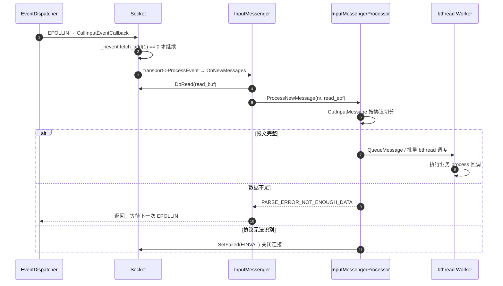

### 2.4 数据发送链路

`Socket::Write` 的核心是**无锁写队列 + KeepWrite 后台 bthread**：

- `StartWrite` 通过 `_write_head.exchange(req)` 抢占写权；
- 抢到的线程先尝试直接写一次；
- 写不完（`EAGAIN`）或 SSL/后台写时，创建 `KeepWrite` bthread 继续消费写队列；
- 写失败统一走 `ReleaseAllFailedWriteRequests` 并 `SetFailed`（`src/brpc/socket.cpp:1643-1820,1824+`）。

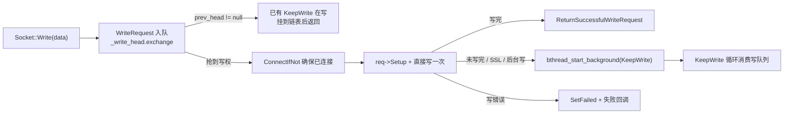

### 2.5 服务端接入链路

服务端由 `Acceptor` 管理监听 Socket：

- `StartAccept` 创建监听 Socket，读事件回调设为 `OnNewConnections`（`src/brpc/acceptor.cpp:57-111`）；
- `OnNewConnectionsUntilEAGAIN` 循环 `accept`，为每个新连接创建独立 `Socket`，绑定协议处理器；
- 支持最大连接数限制、空闲连接清理、停机时 `ELOGOFF` 让客户端尽快切换（`src/brpc/acceptor.cpp:292-397`）。

---

## 3. 调度机制

brpc 的调度分为三层：**bthread 协程调度（CPU）**、**EventDispatcher I/O 调度（fd）**、**LoadBalancer RPC 选路调度（请求）**。

### 3.1 bthread M:N 调度

`TaskControl` 管理 N 个 worker pthread，每个 worker 对应一个 `TaskGroup`；每个 `TaskGroup` 有：

- 本地工作窃取队列 `_rq`；
- 远程队列 `_remote_rq`（其他线程投递的任务）；
- `ParkingLot` 用于无任务时休眠与唤醒；
- 按 `bthread_tag` 隔离的调度组（不同 tag 可有独立并发度）。

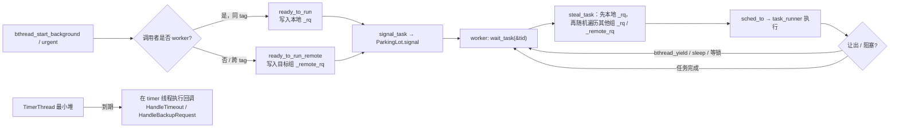

源码要点：

| 行为 | 位置 |
|---|---|
| 工作线程主循环 | `TaskGroup::run_main_task`、`wait_task`（`src/bthread/task_group.cpp:126-195`） |
| 任务入队/远程入队 | `ready_to_run`、`ready_to_run_remote`（`src/bthread/task_group.cpp:846-913`） |
| 跨组窃取 | `TaskControl::steal_task`（`src/bthread/task_control.cpp:625-664`） |
| 唤醒 worker | `TaskControl::signal_task`，单次最多唤醒 2 个，必要时扩容（`src/bthread/task_control.cpp:666-694`） |
| 切换执行 | `TaskGroup::sched_to` / `task_runner`（`src/bthread/task_group.cpp:734+`） |
| 定时器 | `TimerThread` 每个 bucket 维护最小堆，`schedule/unschedule`（`src/bthread/timer_thread.cpp`） |

### 3.2 EventDispatcher 事件调度

- 每个 EventDispatcher 是一个全局优先级 bthread（`BTHREAD_NEVER_QUIT | BTHREAD_GLOBAL_PRIORITY`），内部 `epoll_wait`（`src/brpc/event_dispatcher_epoll.cpp:58-94,203-250`）。
- 采用**边缘触发**：`EPOLLET`，读事件和写事件分两轮处理，减小写延迟对读的影响。
- `Socket::OnInputEvent` 的 `_nevent` 计数避免"同一 fd 多个事件同时到达时创建多个处理协程"，把并发处理收敛为单消费者。
- 连接/写事件通过 `IOEvent` 注册到 epoll；连接超时用 `bthread_timer_add` 实现（`src/brpc/socket.cpp:1281-1395`）。

### 3.3 RPC 请求调度

`Controller::IssueRPC` 是请求调度的中枢（`src/brpc/controller.cpp:1315+`）：

1. 计算剩余超时；
2. 生成带版本号的 `CallId`（首次、重试、backup 各占一个版本，迟到响应自动丢弃）；
3. 选择目标 Socket：
   - `bind_sock` 亲和（如 MySQL 事务）；
   - `SingleServer` 直连；
   - 否则 `LoadBalancer::SelectServer`，传入 `ExcludedServers` 排除本次已失败节点；
4. 打包请求、`Socket::Write`；
5. 同步调用 `Join` 等待，异步调用由回调唤醒。

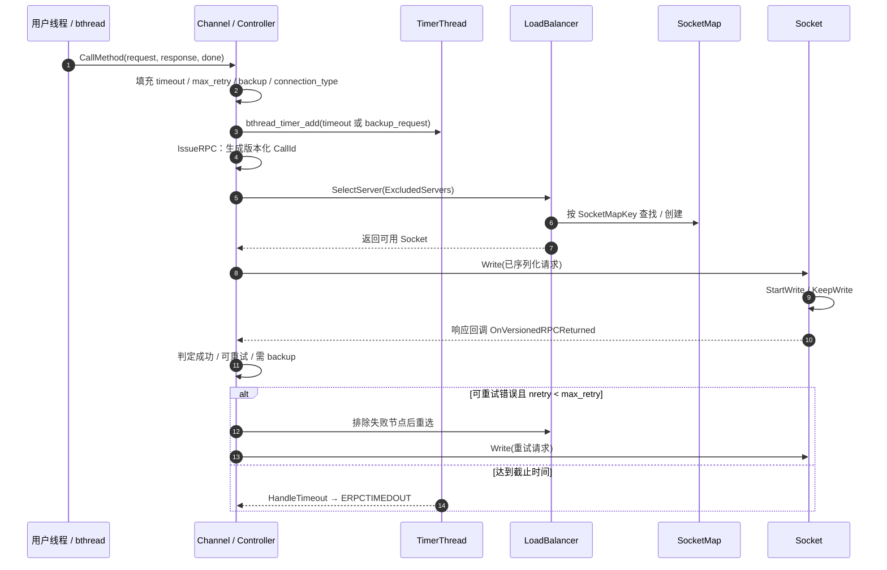

服务端侧还有并发控制：`max_concurrency` / `AdaptiveMaxConcurrency` / `ConcurrencyLimiter`（`src/brpc/server.cpp:760-782,1089-1096`），超限时返回 `ELIMIT`，而熔断器会忽略 `ELIMIT`，避免下游整体过载时误隔离。

---

## 4. 故障识别与恢复机制

brpc 的故障处理是**分层**的：传输层先感知连接错误，请求层做超时/重试/backup，节点层做熔断隔离，集群层做恢复限流。各层协同，避免"一个节点慢"升级为"整个集群雪崩"。

### 4.1 分层故障识别

| 层级 | 识别手段 | 典型错误/状态 | 主要源码 |
|---|---|---|---|
| 连接层 | read/write 返回值、EOF、connect 超时 | `EFAILEDSOCKET`、`EEOF`、`ECONNREFUSED`、`ECONNRESET`、`EPIPE`、`ETIMEDOUT` | `socket.cpp`、`input_messenger.cpp` |
| 请求层 | `bthread_timer` 超时 | `ERPCTIMEDOUT`（不默认重试） | `controller.cpp`、`channel.cpp` |
| 节点层 | 熔断器短/长窗口 EMA 错误代价 | 错误率/错误代价超阈值 → 隔离 | `circuit_breaker.cpp` |
| 集群层 | 全部节点不可用 | `EHOSTDOWN`，进入 recovering | `randomized_load_balancer.cpp`、`cluster_recover_policy.cpp` |
| 主动探测 | TCP connect / HTTP 健康路径 | 恢复成功 → `Revive` | `details/health_check.cpp` |

### 4.2 连接失败 → 健康检查 → 自愈

`Socket::OnFailed`（由 `VersionedRefWithId::SetFailed` 回调，`src/brpc/socket.cpp:919-950`）是故障入口：

1. 记录 `_error_code/_error_text`；
2. 若 `HCEnabled()`：
   - `circuit_breaker.MarkAsBroken()` 更新隔离时长；
   - `StartHealthCheck(id, isolation_duration_ms)` 延迟启动探测；
3. 唤醒所有等待 EPOLLOUT 的线程；
4. 重置所有未完成 RPC（`bthread_id_list_reset2_pthreadsafe`），让上层立即感知失败；
5. 通知所有 Stream 失败。

健康检查任务 `HealthCheckTask::OnTriggeringTask`（`src/brpc/details/health_check.cpp:155-224`）：

- 首次触发时 `WaitAndReset(2)`：等待引用数降到健康检查相关引用数，关闭旧 fd、清空解析上下文，并 **`circuit_breaker.Reset()`**（`src/brpc/socket.cpp:991-1080`）；
- 调用 `Socket::CheckHealth()`：默认做一次带超时的 `Connect`（`health_check_timeout_ms` 默认 500ms）；
- 若配置了 `health_check_path`，改用 HTTP 健康检查 Channel 周期性请求该路径；
- 成功 → `Revive(2)`，恢复 `SocketId` 可寻址性，`_hc_count = 0`，停止探测；
- 失败 → `++_hc_count`，按 `_health_check_interval_s` 继续探测；
- `ESTOP` → 放弃探测（进程/任务停止）。

> 注意：`Revive` 只恢复可寻址性，不会立刻重建 fd。下一次 `Write` 走 `ConnectIfNot` 惰性重连，避免恢复瞬间的惊群。

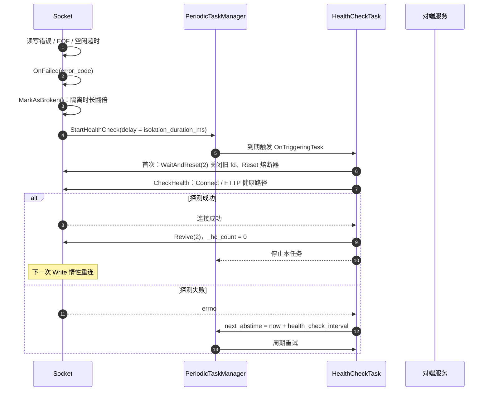

### 4.3 熔断器（节点级隔离）

`CircuitBreaker` 挂在 Socket 的 `SharedPart` 上，即**按服务节点（主 Socket/连接池共享部分）**统计（`src/brpc/socket.cpp:199,1105-1111`）。是否启用由 `ChannelOptions.enable_circuit_breaker` 控制，默认关闭。

算法要点（`src/brpc/circuit_breaker.cpp`）：

- **双窗口 EMA**：
  - 短窗口默认 1500 个样本、错误率上限 10%；
  - 长窗口默认 3000 个样本、错误率上限 5%；
  - 错误代价 `error_cost` 与延迟相关，失败请求的延迟被截断到平均延迟的 2 倍，避免"超慢失败"过度惩罚。
- **忽略 `ELIMIT`、`ECANCELED`**：前者表示下游整体过载，不应隔离单节点；后者是用户取消，不代表节点故障。
- **隔离**：`MarkAsBroken()` 置 `_broken=true`，`OnCallEnd` 在隔离期间恒返回 false；在上次 `Reset()` 后的 30s 内，每次再次隔离都会把隔离时长翻倍，范围 `[100ms, 30s]`（`circuit_breaker_min/max_isolation_duration_ms`，`UpdateIsolationDuration()`）。
- **半开**：`FLAGS_circuit_breaker_half_open_window_size > 0` 时，`Reset()` 进入半开，连续 N 次成功才闭合，任意一次失败立即重新打开；默认为 0（关闭）。
- **反馈路径**：`Controller::Call::OnComplete` 在 `enable_circuit_breaker` 时调用 `Socket::FeedbackCircuitBreaker(error_code, latency)`；隔离动作是 `SetFailed(main_socket_id())`，从而触发 4.2 的健康检查（`src/brpc/controller.cpp:1029-1045`）。

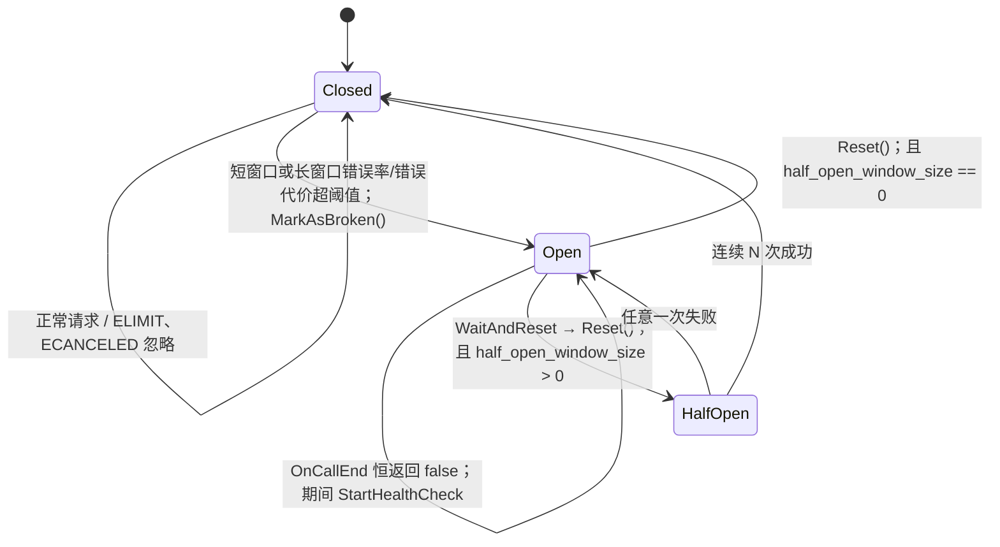

### 4.4 重试（请求级恢复）

默认重试策略 `RpcRetryPolicy::DoRetry` 只对**连接类/协议类错误**重试（`src/brpc/retry_policy.cpp:25-43`）：

```
EFAILEDSOCKET, EEOF, EHOSTDOWN, ELOGOFF, ETIMEDOUT,
ELIMIT, ENOENT, EPIPE, ECONNREFUSED, ECONNRESET,
ENODATA, EOVERCROWDED, EH2RUNOUTSTREAMS
```

注意：

- `ETIMEDOUT` 是**连接超时**，可重试；`ERPCTIMEDOUT` 是**整个 RPC 超时**，默认不重试；
- `ECANCELED`（用户取消）默认不重试；
- 重试次数由 `max_retry` 控制（`ChannelOptions` 默认 3）；
- 每次重试把当前节点加入 `ExcludedServers`，在 `RETRY_AVOIDANCE` 范围内避免重复选中同一节点（`src/brpc/controller.cpp:913-955`）；
- 支持固定/抖动退避（`RpcRetryPolicyWithFixedBackoff`、`RpcRetryPolicyWithJitteredBackoff`），且可配置是否允许在 pthread 中退避；
- 每次调用使用独立的版本化 `CallId`，迟到的旧响应会被 `OnVersionedRPCReturned` 丢弃（`src/brpc/controller.cpp:1326-1334`）。

### 4.5 Backup Request（延迟长尾抑制）

当 `backup_request_ms >= 0` 且小于 `timeout_ms` 时，`Channel::CallMethod` 会注册一个 backup 定时器（`src/brpc/channel.cpp:618-639`）：

1. 到点仍未返回 → `HandleBackupRequest` 以 `EBACKUPREQUEST` 结束当前 call；
2. `OnVersionedRPCReturned` 识别 `EBACKUPREQUEST`，把原节点加入 `ExcludedServers`，保留 `_unfinished_call`，再发一次请求（`src/brpc/controller.cpp:876-912`）；
3. **先返回者胜出**：成功响应会结束 RPC，失败或迟到的 backup 响应被忽略；
4. `BackupRequestPolicy` 可进一步限流（如 `max_backup_ratio`），防止 backup 放大流量（`src/brpc/backup_request_policy.h`）。

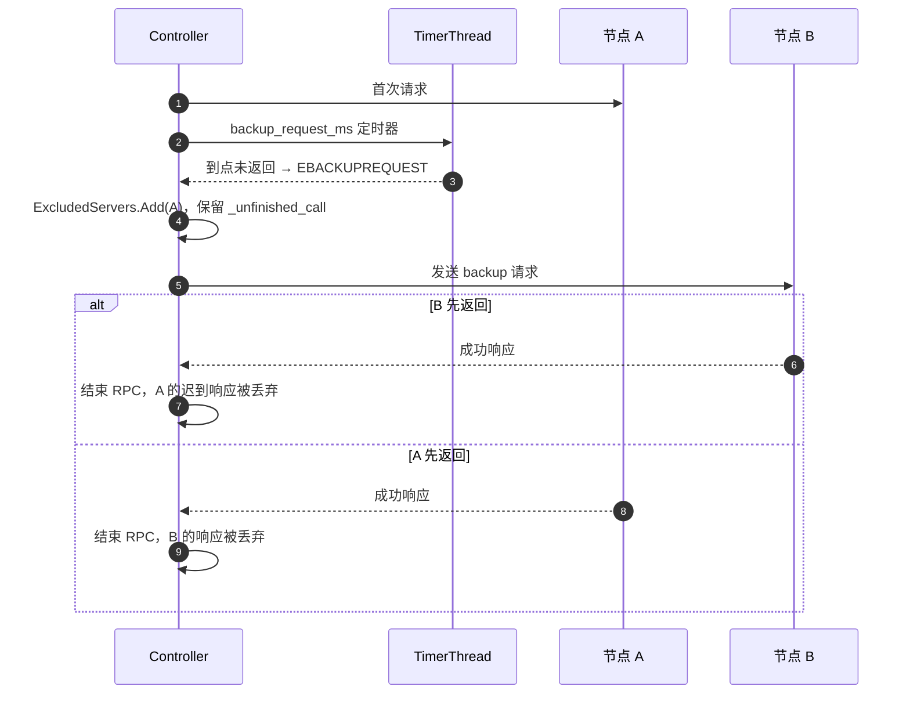

### 4.6 集群级恢复（避免恢复瞬间雪崩）

当所有节点都不可用时，随机/轮询 LB 会调用 `ClusterRecoverPolicy::StartRecover()` 进入恢复态（`src/brpc/policy/randomized_load_balancer.cpp:96-133`）。默认策略 `DefaultClusterRecoverPolicy` 的行为（`src/brpc/cluster_recover_policy.cpp`）：

- 参数：`min_working_instances=n`（期望最小可用实例数）、`hold_seconds`（稳定保持时间）；
- 恢复态中，`DoReject` 以 **`q/n`** 的概率放行请求（`q` 为当前可用节点数）：`fast_rand_less_than(n) >= q` 时拒绝；
- 若可用节点数大于 0 且在 `hold_seconds` 内保持不变，则认为集群已稳定，退出恢复态，全部放行；
- 目的：所有节点刚恢复时，避免全部流量瞬间压向少数刚起来的节点，再次把它们打挂。

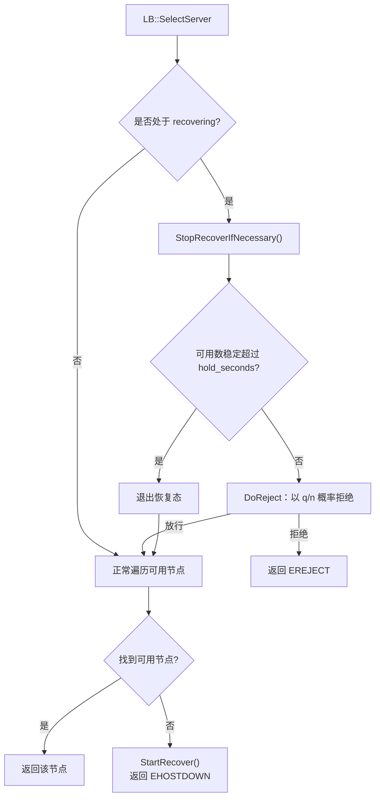

### 4.7 故障处理总流程

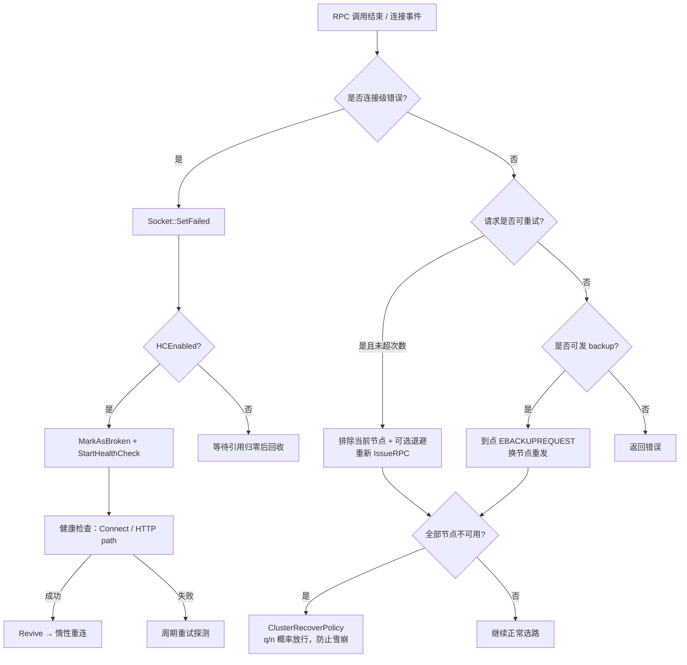

---

## 5. 关键参数速查

| 参数 | 默认值 | 作用 | 位置 |
|---|---|---|---|
| `health_check_interval` | 3s | 失败 Socket 的健康检查周期 | `src/brpc/socket_map.cpp:34` |
| `health_check_timeout_ms` | 500ms | 单次健康检查连接超时 | `src/brpc/health_check_option.h:29` |
| `idle_timeout_second` | 30s | pooled 连接空闲回收 | `src/brpc/socket_map.cpp:39` |
| `defer_close_second` | 0 | 无引用连接延迟关闭 | `src/brpc/socket_map.cpp:44` |
| `connect_timeout_ms` | 200ms | 建连超时 | `src/brpc/channel.cpp:57` |
| `timeout_ms` | 500ms | RPC 总超时 | `src/brpc/channel.cpp:58` |
| `backup_request_ms` | -1（关闭） | backup 请求触发时间 | `src/brpc/channel.cpp:59` |
| `max_retry` | 3 | 最大重试次数 | `src/brpc/channel.cpp:60` |
| `enable_circuit_breaker` | false | 是否启用熔断统计/隔离 | `src/brpc/channel.cpp:61` |
| `circuit_breaker_short_window_size` | 1500 | 短窗口样本数 | `src/brpc/circuit_breaker.cpp:30` |
| `circuit_breaker_long_window_size` | 3000 | 长窗口样本数 | `src/brpc/circuit_breaker.cpp:32` |
| `circuit_breaker_short/long_window_error_percent` | 10% / 5% | 窗口错误率阈值 | `src/brpc/circuit_breaker.cpp:34-37` |
| `circuit_breaker_min/max_isolation_duration_ms` | 100ms / 30s | 隔离时长范围 | `src/brpc/circuit_breaker.cpp:44-47` |
| `circuit_breaker_half_open_window_size` | 0（关闭） | 半开恢复探测窗口 | `src/brpc/circuit_breaker.cpp:50` |
| `min_working_instances` / `hold_seconds` | LB 参数 | 集群恢复放行概率与稳定时间 | `src/brpc/cluster_recover_policy.cpp:110-140` |
| `bthread_concurrency` | 见 bthread flag | worker pthread 数量 | `src/bthread/bthread.cpp` |

---

## 6. 关键源码索引

| 主题 | 文件 |
|---|---|
| RPC 生命周期 / 重试 / backup / 熔断反馈 | [controller.cpp](../src/brpc/controller.cpp) |
| 建连、超时、backup 定时器 | [channel.cpp](../src/brpc/channel.cpp) |
| Socket 状态机、读写、失败、健康检查入口 | [socket.cpp](../src/brpc/socket.cpp)、[socket.h](../src/brpc/socket.h)、[socket_inl.h](../src/brpc/socket_inl.h) |
| 版本化引用 / 防悬垂 ID | [versioned_ref_with_id.h](../src/brpc/versioned_ref_with_id.h) |
| 连接共享、空闲回收、孤儿连接清理 | [socket_map.cpp](../src/brpc/socket_map.cpp) |
| 服务发现与列表刷新 | [naming_service_thread.cpp](../src/brpc/details/naming_service_thread.cpp)、[periodic_naming_service.cpp](../src/brpc/periodic_naming_service.cpp) |
| 健康检查任务与 HTTP 探活 | [health_check.cpp](../src/brpc/details/health_check.cpp) |
| 熔断器 | [circuit_breaker.cpp](../src/brpc/circuit_breaker.cpp) |
| 重试策略 | [retry_policy.cpp](../src/brpc/retry_policy.cpp) |
| backup request 策略 | [backup_request_policy.h](../src/brpc/backup_request_policy.h) |
| 集群恢复策略 | [cluster_recover_policy.cpp](../src/brpc/cluster_recover_policy.cpp) |
| 随机/轮询 LB 的恢复接入 | [randomized_load_balancer.cpp](../src/brpc/policy/randomized_load_balancer.cpp)、[round_robin_load_balancer.cpp](../src/brpc/policy/round_robin_load_balancer.cpp) |
| 读事件入口与协议切分 | [input_messenger.cpp](../src/brpc/input_messenger.cpp)、[input_messenger_processor.cpp](../src/brpc/input_messenger_processor.cpp) |
| epoll 事件循环 | [event_dispatcher_epoll.cpp](../src/brpc/event_dispatcher_epoll.cpp) |
| bthread 调度 | [task_control.cpp](../src/bthread/task_control.cpp)、[task_group.cpp](../src/bthread/task_group.cpp)、[timer_thread.cpp](../src/bthread/timer_thread.cpp) |
| 服务端接入 | [acceptor.cpp](../src/brpc/acceptor.cpp) |

---

## 7. 设计小结

1. **连接层做"共享 + 版本化引用"**：`SocketMap` 按对端共享连接，`VersionedRefWithId` 让失败/回收与并发访问解耦，避免锁竞争和悬垂指针。
2. **I/O 与业务解耦**：`EventDispatcher` 只负责 epoll 收事件，`Socket::OnInputEvent` 做单消费者去重，`InputMessenger` 批量切分后交给 bthread，兼顾吞吐与延迟。
3. **调度分层**：bthread 负责 CPU 侧 M:N 调度与工作窃取，LB 负责请求侧选路，TimerThread 负责超时/backup，三者职责清晰。
4. **故障恢复分层**：连接错误 → 健康检查自愈；请求错误 → 重试/backup；节点持续异常 → 熔断隔离；集群全挂 → 恢复限流。每层都有"快速失败 + 渐进恢复"的机制，避免级联故障。
5. **恢复以"探测 + 惰性重连"为主**：健康检查只验证可达性，真正的 fd 重建推迟到下一次写入，减少恢复瞬间的资源竞争和惊群。
